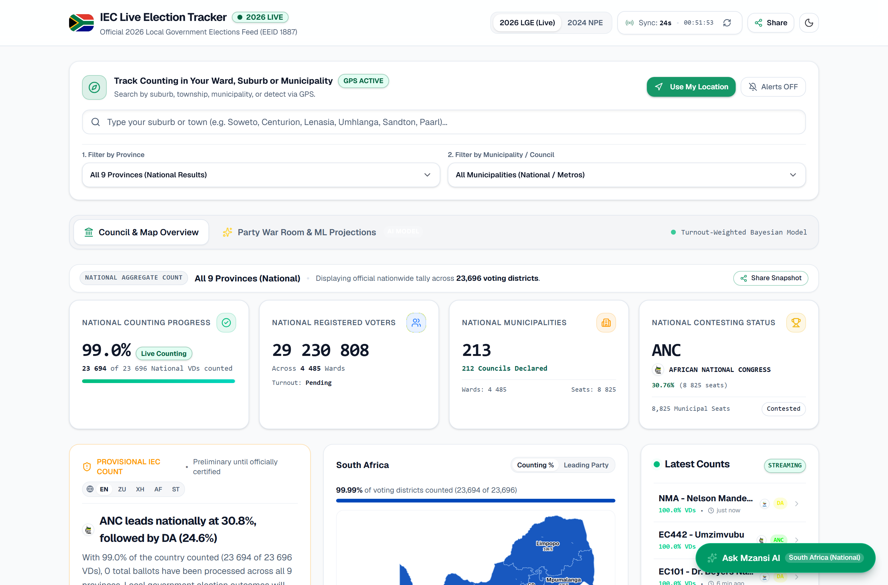
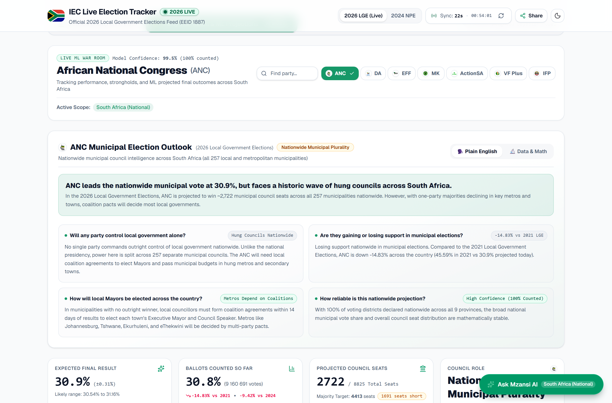
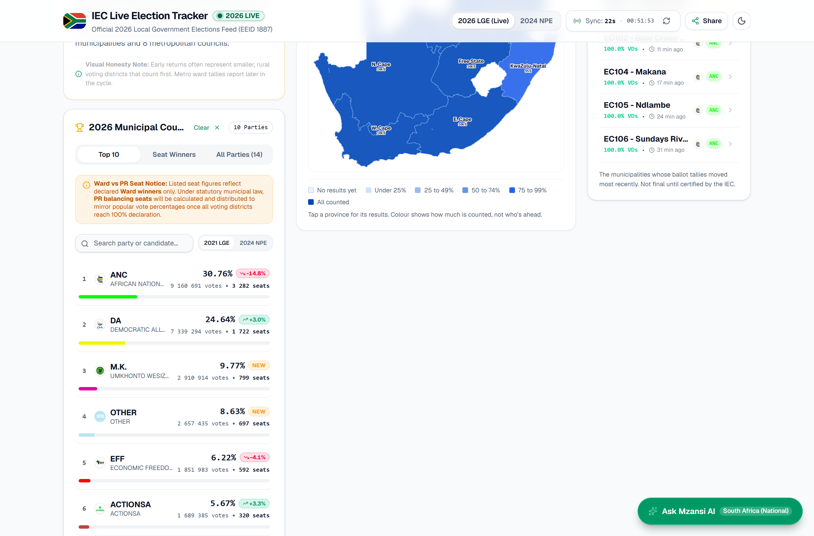
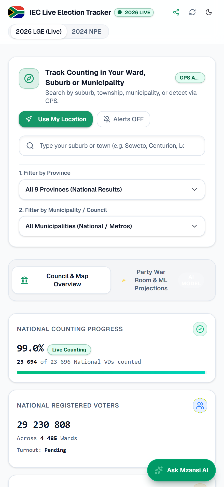
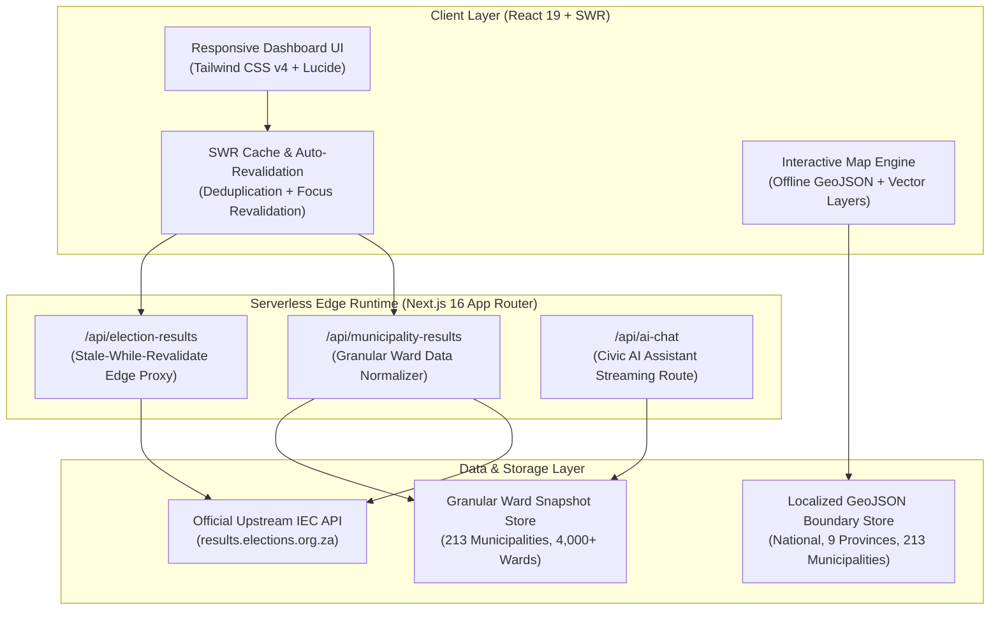

# Mzansi Civic Election Tracker

> A high-performance, real-time civic election results dashboard and analytics platform built with **Next.js 16 (App Router)**, **TypeScript**, and **Tailwind CSS**.

[](https://iec-election-tracker.vercel.app)
[](https://nextjs.org)
[](https://react.dev)
[](https://www.typescriptlang.org)
[](https://tailwindcss.com)
[](https://vercel.com)

**Live Production Application:** [https://iec-election-tracker.vercel.app](https://iec-election-tracker.vercel.app)

---

## About the Project

**Mzansi Civic Election Tracker** is a production-grade, full-stack web application built to deliver real-time election results, interactive geographic ward drill-downs, and coalition modeling across all **257 South African municipalities**, **9 provinces**, and the **400-seat National Assembly**.

Engineered for election-night traffic spikes, the platform pairs a **Next.js 16 (App Router)** serverless edge proxy with **SWR** client-side state synchronization and pre-compiled local **GeoJSON** vector maps—ensuring sub-50ms map interactions and uninterrupted availability even when upstream Electoral Commission (IEC) feeds experience heavy load.

---

## Interface & Responsive Showcase

### Desktop Dashboard & Geographic Drill-Down


### Party War Room & Civic Intelligence


### Leaderboard & Provincial Matrix vs. Mobile Responsive Layout
| Desktop Standings & Map Matrix | Mobile Viewport (iPhone 16 Pro Max) |
| :---: | :---: |
|  |  |

---

## System Architecture



---

## Tech Stack & Architectural Decisions

### 1. Framework & Runtime: Next.js 16 (App Router)
- **Hybrid Rendering Model:** Uses React Server Components (RSC) for initial page scaffolds and static assets, combined with client-side interactive widgets for live polling.
- **Turbopack Build Pipeline:** Leverages Next.js Turbopack for ultra-fast local development and production bundle optimization.
- **Serverless API Routes:** Decouples the client from upstream services, eliminating CORS issues and hiding upstream API structures.

### 2. State Management & Real-Time Sync: SWR 2.5
- **Stale-While-Revalidate (SWR):** Displays cached data instantly on first render while background-revalidating against the edge API every 30 seconds.
- **Request Deduplication & Window Focus Revalidation:** Eliminates redundant network requests across multiple mounting components and automatically syncs the latest numbers when the user switches tabs back to the dashboard.
- **Monotonic Progress Floor:** Prevents UI regressions by guaranteeing that reported counts never move backwards if upstream polling encounters transient cache jitter.

### 3. Styling & Design System: Tailwind CSS v4
- **High-Craft Civic Interface:** Crisp, authentic retail/editorial experience tailored for maximum legibility across mobile, tablet, and desktop viewports.
- **Zero Emoji Clutter:** Exactly zero unicode emojis in the DOM. All indicators use clean, accessible inline SVG iconography (Heroicons style) with dedicated `aria-hidden` attributes.
- **Responsive Layout:** Zero horizontal scroll (`scrollWidth === clientWidth`) across 320px, 375px, 440px (iPhone), 768px (iPad), and 1280px (Desktop) viewports.

### 4. Interactive Mapping: Localized GeoJSON & Vector Boundaries
- **Zero-Latency Navigation:** All South African national, provincial, and municipal boundaries are pre-processed and served locally from `/maps/` as optimized GeoJSON files, eliminating heavy third-party mapping dependencies.
- **Interactive Drill-Down:** Seamless two-way binding between the geographic map, provincial matrix, and municipal council leaderboards.

### 5. Programmatic Video Generation: Remotion 4.0
- **Automated Broadcast Production:** Integrated with **Remotion** (`src/remotion/ProductFilm.tsx`) to render programmatic, data-driven election highlight reels and product demonstration videos directly from code using React components.

---

## Key Features

- **4-Card Real-Time KPI Deck:**
  - Voting District (VD) Progress (`VDs Complete / VD Expected` + animated progress bar)
  - Voter Turnout Rate & Total Ballots Processed
  - Valid vs. Spoilt & Special Ballots
  - Leading Party Standings
- **400-Seat Parliamentary Majority Visualizer:**
  - Dynamic proportional seat bar mapped with official party brand colors
  - 201-seat majority indicator line
  - Interactive hover tooltips with percentage breakdown of the National Assembly
- **Ranked Leaderboard Table:**
  - Official party logos and badges
  - High-precision vote counters with monospace tabular figures (`tabular-nums`)
  - Live search & quick filters (*Top 10*, *Seat Winners*, *All Parties*)
- **Interactive Coalition Simulator:**
  - Test government coalition combinations against statutory majority thresholds
  - One-click presets: *Government of National Unity (GNU)*, *ANC + DA*, *MK + EFF*
- **9-Province Regional Counting Matrix:**
  - Dedicated progress cards for each South African province showing completion rates and local leading parties

---

## Project Structure

```text
iec-election-tracker/
├── src/
│   ├── app/                          # Next.js 16 App Router
│   │   ├── api/
│   │   │   ├── election-results/     # SWR Edge cache proxy for IEC feeds
│   │   │   ├── municipality-results/ # Granular ward results API
│   │   │   └── ai-chat/              # Civic AI assistant endpoint
│   │   ├── layout.tsx                # Global root layout and font configurations
│   │   ├── page.tsx                  # Main election dashboard entrypoint
│   │   └── video/                    # Programmatic video generation route
│   ├── components/                   # Modular UI components
│   │   ├── Header.tsx                # Navigation header
│   │   ├── KpiCards.tsx              # 4-card KPI metrics deck
│   │   ├── PartyLeaderboard.tsx      # Ranked party standings table
│   │   ├── CoalitionBuilder.tsx      # Interactive coalition simulator
│   │   ├── SouthAfricaMap.tsx        # Offline GeoJSON interactive map
│   │   ├── PartyWarRoom.tsx          # Municipal ward-level drilldown & analytics
│   │   └── AskMzansiAiModal.tsx      # Civic query modal
│   ├── data/
│   │   └── granular/                 # Offline ward & municipal snapshot data (213 councils)
│   ├── lib/                          # Core business logic and client utilities
│   │   ├── iec-client.ts             # IEC upstream API client and fallback orchestrator
│   │   ├── historical-data.ts        # Official historical election benchmarks
│   │   ├── ml-projection-engine.ts   # Election projection and seat allocation logic
│   │   └── utils.ts                  # Tailwind class mergers (clsx + twMerge)
│   ├── remotion/                     # Remotion video compositions
│   └── types/                        # Strict TypeScript interfaces and schemas
├── public/
│   ├── maps/                         # Pre-compiled provincial & municipal GeoJSON files
│   └── parties/                      # Verified offline SVG party brand assets
├── tests/                            # Automated test suite
├── package.json
├── tsconfig.json
└── next.config.ts
```

---

## Getting Started

### Prerequisites
- Node.js `v20.0.0` or higher (compatible with Node `v24+`)
- npm `v10.0.0` or higher

### Installation & Setup

1. **Clone the repository:**
   ```bash
   git clone https://github.com/reamogetswemolefe0190-cmd/iec-election-tracker.git
   cd iec-election-tracker
   ```

2. **Install dependencies:**
   ```bash
   npm install
   ```

3. **Start the local development server:**
   ```bash
   npm run dev
   ```
   Open [http://localhost:3000](http://localhost:3000) in your browser.

---

## Build & Testing Commands

```bash
# Run unit and integration validation suite
npm run test:engine

# Create an optimized production build
npm run build

# Start the production server
npm run start

# Run ESLint check
npm run lint
```

---

## Deployment

The application is configured for continuous deployment on **Vercel**:
- Push to the `main` branch automatically triggers preview and production builds.
- Route handlers utilize Vercel Edge caching headers (`Cache-Control: s-maxage=30, stale-while-revalidate=60`).

---

## Author & Contact

**Reamogetswe Molefe**  
- **GitHub:** [@reamogetswemolefe0190-cmd](https://github.com/reamogetswemolefe0190-cmd)  
- **Production URL:** [https://iec-election-tracker.vercel.app](https://iec-election-tracker.vercel.app)
